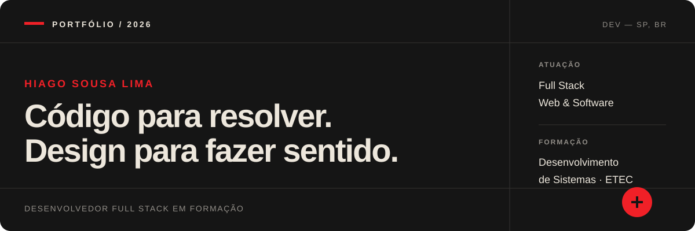
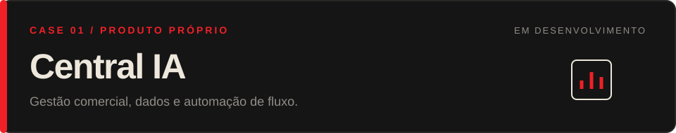
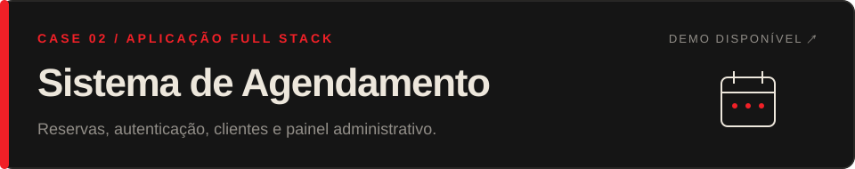
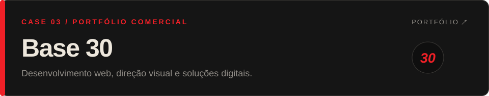

  

  <a href="https://github.com/hiagosousalima51-droid"><strong>GITHUB</strong></a>
  &nbsp;·&nbsp;
  <a href="https://base-30-worn.vercel.app/"><strong>PORTFÓLIO BASE 30</strong></a>
  &nbsp;·&nbsp;
  <a href="https://base-30-worn.vercel.app/#contato"><strong>CONTATO</strong></a>

 

### `01 / PERFIL`

## Desenvolvedor Full Stack em formação.

Sou estudante de **Desenvolvimento de Sistemas na ETEC**. Tenho interesse em desenvolvimento web, engenharia de software e inteligência artificial — especialmente em como transformar uma necessidade real em um produto claro, funcional e bem apresentado.

Construo projetos próprios e acadêmicos e também desenvolvo soluções comerciais por meio da **Base 30**, meu portfólio de desenvolvimento web. Busco uma oportunidade de **estágio em desenvolvimento de software** para aprofundar meus fundamentos, colaborar com uma equipe e evoluir em projetos reais.

> **Código para resolver. Design para fazer sentido.**

 

### `02 / TECNOLOGIAS`

## O que uso para construir

| Área | Tecnologias |
| :--- | :--- |
| **Front-end** | `HTML` `CSS` `JavaScript` `Bootstrap` |
| **Back-end** | `Node.js` `Express` |
| **Dados & serviços** | `PostgreSQL` `SQL Server` `Supabase` |
| **Outras linguagens** | `Python` `C++` |
| **Fluxo de trabalho** | `Git` `GitHub` `VS Code` `Vercel` |

Minha prioridade hoje é consolidar o desenvolvimento Full Stack com JavaScript, Node.js, bancos relacionais, autenticação e organização de código.

 

### `03 / PROJETOS SELECIONADOS`

  

Plataforma própria de gestão comercial com dashboard, gerenciamento de leads, importação de planilhas, autenticação e integração com banco de dados.

`PRODUTO PRÓPRIO` &nbsp; `FULL STACK` &nbsp; `CÓDIGO PRIVADO`

O sistema está em desenvolvimento e hospedado em ambiente privado. O código-fonte, dados e acesso público não são disponibilizados.

 

  

Sistema Full Stack para gestão de agendamentos, com fluxo de reservas, autenticação, área do cliente, painel administrativo e banco de dados. O Ateliê Aurora é a versão principal de demonstração de uma base adaptável a diferentes negócios.

`JAVASCRIPT` &nbsp; `NODE.JS` &nbsp; `EXPRESS` &nbsp; `POSTGRESQL` &nbsp; `SUPABASE`

**[Abrir demonstração ↗](https://atelie-aurora-agendamentos.vercel.app/)**

 

  

Portfólio comercial onde apresento serviços, sites e demonstrações de soluções digitais para pequenos negócios. É também o espaço em que aplico desenvolvimento front-end, direção visual e comunicação de produto.

`DESENVOLVIMENTO WEB` &nbsp; `UI RESPONSIVA` &nbsp; `PROJETOS COMERCIAIS`

**[Conhecer a Base 30 ↗](https://base-30-worn.vercel.app/)**

 

#### Outros experimentos

**[Painel de Cotação ↗](https://github.com/hiagosousalima51-droid/painel-cotacao)** — aplicação em JavaScript que consulta uma API de cotações, atualiza a interface e trata estados de carregamento e falha. **[Ver demonstração](https://painel-cotacao-sigma.vercel.app/)**.

 

### `04 / AGORA`

## Em evolução contínua

- Fundamentos de engenharia de software e organização de código
- Desenvolvimento Full Stack com Node.js e bancos relacionais
- Autenticação, segurança e boas práticas para aplicações web
- Aplicações de inteligência artificial em produtos digitais

 

---

  <strong>Aberto a oportunidades de estágio em desenvolvimento de software.</strong> 
  São Paulo, Brasil · Projetos técnicos e comerciais

