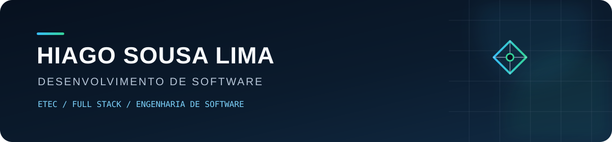

  

  Estudante de Desenvolvimento de Sistemas na ETEC • Desenvolvimento Full Stack • Engenharia de Software

  <a href="https://github.com/hiagosousalima51-droid">GitHub</a>
  ·
  <a href="https://base-30-worn.vercel.app/">Base 30</a>

## Olá, eu sou o Hiago 👋

Sou estudante de **Desenvolvimento de Sistemas na ETEC** e desenvolvo projetos próprios, acadêmicos e comerciais. Tenho interesse em **engenharia de software**, **desenvolvimento Full Stack** e **inteligência artificial**.

Atualmente, estou aprofundando meus fundamentos enquanto construo aplicações web, sistemas com autenticação e banco de dados e interfaces responsivas. Também desenvolvo projetos para pequenos negócios por meio da **Base 30**.

Estou em busca de uma oportunidade de **estágio em desenvolvimento de software**, onde eu possa aprender com uma equipe, contribuir com projetos reais e evoluir tecnicamente.

## Tecnologias com as quais já trabalhei

**Front-end**

**Back-end, programação e dados**

**Ferramentas e publicação**

> Essas são tecnologias que já utilizei em estudos e projetos. Continuo aprimorando meus fundamentos e ampliando minha experiência prática.

## Projetos em destaque

### Central IA

Plataforma própria para gestão de leads e acompanhamento comercial. O projeto reúne dashboard, autenticação, banco de dados, importação de planilhas e organização do fluxo de atendimento.

- **Foco:** produto próprio, organização de dados e fluxo comercial
- **Status:** em desenvolvimento, com código-fonte privado
- **Próximo passo:** preparar um repositório público somente para documentação, arquitetura e demonstrações seguras

### Sistema de Agendamento — Ateliê Aurora

Sistema de agendamento desenvolvido a partir de uma base própria, com fluxo de reservas, autenticação, área do cliente e painel administrativo. O Ateliê Aurora é a versão principal usada para apresentar a solução.

- **Foco:** aplicação Full Stack, autenticação e banco de dados
- **Tecnologias trabalhadas:** JavaScript, Node.js, Express, PostgreSQL e Supabase
- **Demonstração:** [atelie-aurora-agendamentos.vercel.app](https://atelie-aurora-agendamentos.vercel.app/)

### Base 30

Portfólio comercial onde apresento serviços de desenvolvimento web e projetos criados para demonstrar soluções para pequenos negócios.

- **Foco:** desenvolvimento web, interfaces responsivas e apresentação de projetos
- **Atuação:** sites institucionais, landing pages e sistemas web
- **Site:** [base-30-worn.vercel.app](https://base-30-worn.vercel.app/)

### Painel de Cotação

Aplicação web que consulta uma API de cotações e apresenta valores atualizados de moedas, com estados de carregamento e tratamento de falhas na requisição.

- **Foco:** JavaScript, consumo de API e atualização da interface
- **Código:** [github.com/hiagosousalima51-droid/painel-cotacao](https://github.com/hiagosousalima51-droid/painel-cotacao)
- **Demonstração:** [painel-cotacao-sigma.vercel.app](https://painel-cotacao-sigma.vercel.app/)

## O que estou estudando agora

- Fundamentos de engenharia de software e organização de código
- Desenvolvimento Full Stack com Node.js e bancos relacionais
- Autenticação, segurança e boas práticas para aplicações web
- Aplicações de inteligência artificial em produtos digitais

## Contato

- Perfil técnico: [GitHub](https://github.com/hiagosousalima51-droid)
- Projetos e contato comercial: [Base 30](https://base-30-worn.vercel.app/#contato)

---

  Aberto a oportunidades de estágio em desenvolvimento de software.

